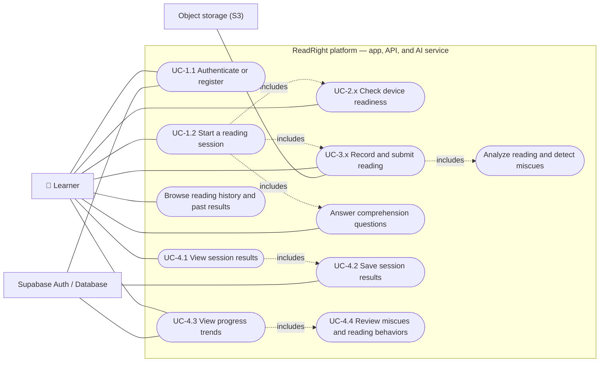

# Figure D-1: ReadRight use-case diagram

The diagram covers the learner-facing flow documented in `readright-app`'s `dev` branch and the supporting persistence and recording-upload behavior implemented across the repositories. The frontend's route map names UC-1.1, UC-1.2, UC-2.x, UC-3.x, and UC-4.1 through UC-4.4; it does not assign an ID to the comprehension quiz or history pages, so those are shown without invented IDs. I did not find a separate pre-existing Figure D-1 file in the linked repositories.

Sources: `readright-app` `dev` branch (`src/App.jsx`, `src/lib/api.js`, `src/pages/SessionScreen.jsx`, `ARCHITECTURE.md`); `readright-api` `dev` branch (session, result, dashboard, and storage features); `readright-ai` `dev` branch (`server/app/routes/analyses.py`).
