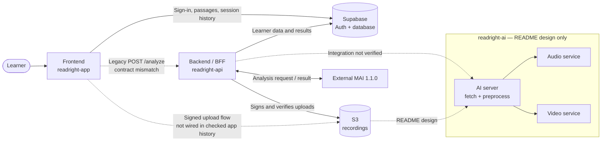

# Figure D-3: System architecture diagram

Solid arrows show the current app/backend responsibilities described in the repositories. Dashed arrows mark a legacy or unverified integration. The checked `readright-ai` snapshot contains only its README.
