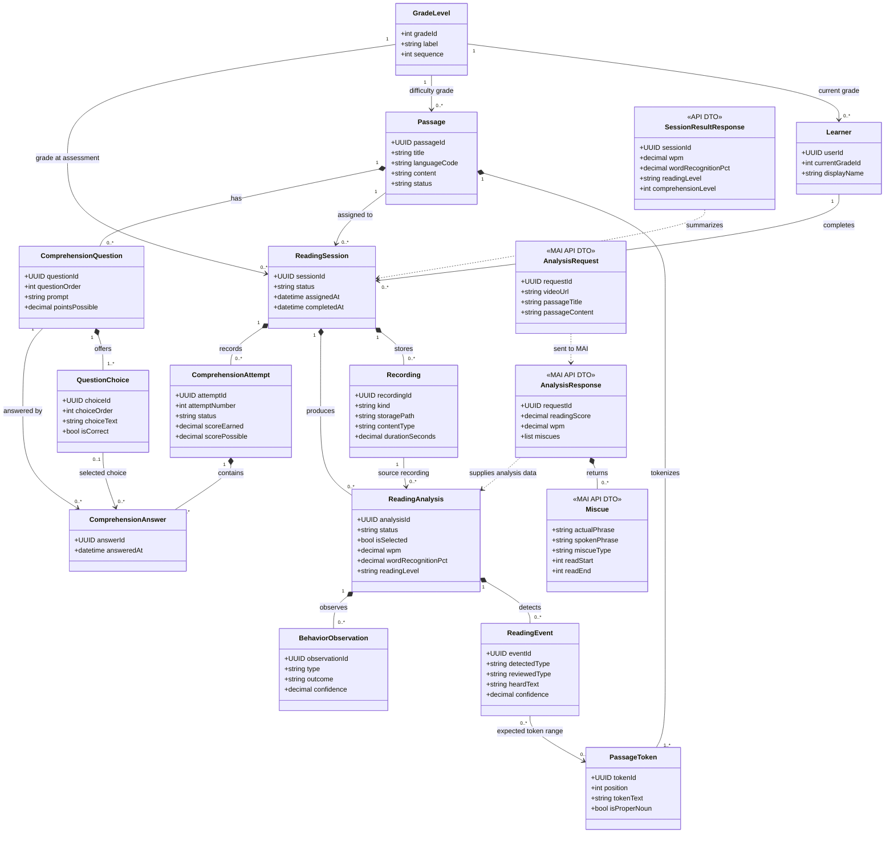

# Figure D-4: ReadRight domain class diagram

This is a domain and data-contract class diagram for the learner workflow shown in the frontend repository: sign in, complete a reading session and comprehension quiz, view results, and review progress. The frontend uses React function components and hooks, so its pages are not represented as classes. The diagram focuses on the classes and relationships shared through the app API, backend data model, and MAI analysis contract. I could not find a separate Figure D-1 file in the linked repositories; the use-case flow is documented in `readright-app` `dev` branch `src/App.jsx`.

Sources: `readright-app` `dev` branch (`src/App.jsx`, `src/lib/api.js`); `readright-api` (`app/features/me/models.py`, `app/features/mai/models.py`, and Supabase schema migrations); `readright-ai` `dev` branch (`server/app/models.py`).
